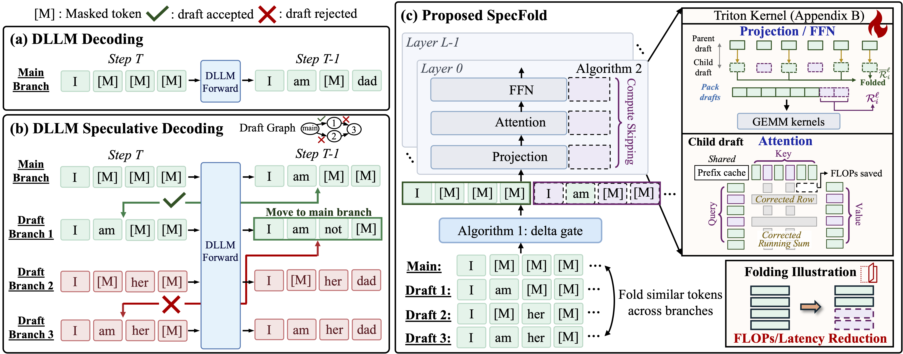

# SpecFold

This repository contains the implementation of the paper, *SpecFold: Folding Multi-Branch Redundancy for Faster Speculative Decoding in Diffusion Language Models*. Specfold targets the forward and verification step cost in multi-branch speculative Diffusion Language Models (DLLM) decoding with an algorithm-system co-design. Across two DLLM families, five models, and five standard benchmarks, SpecFold achieves up to $1.64\times$ decoding TPS over Spiffy and up to $1.99\times$ over vanilla decoding, unlocking the effective speedup with speculative decoding in DLLM.

## News

PLACEHOLDER

## Key Features and Methodology



*(a) DLLM decoding; (b) multi-branch speculative decoding verifies the main branch with draft branches in one forward and reuses accepted drafts; (c) SpecFold folds the computation required by multi-branch speculative DLLM decoding by identify similar positions across drafts.*


## Models and benchmarks

| Model Family | `--model` |
|---|---|
| Fast-dLLM-v2 | `fastdllm_v2_1.5b`, `fastdllm_v2_7b` |
| Nemotron-Labs-Diffusion | `nld_3b`, `nld_8b`, `nld_14b` |

`--dataset`: `gsm8k`, `math500`, `humaneval`, `mbpp` (MBPP+), `ifeval`. All evaluated with 0-shot.

## Installation

Tested with Python ≥ 3.10:

```bash
python -m venv .venv && source .venv/bin/activate
python -m pip install -r requirements.txt
python -m pip install -e .
export HF_HOME=/path/to/hf_cache
export HF_ALLOW_CODE_EVAL=1 TOKENIZERS_PARALLELISM=false
```

## Usage

One command evaluates the three methods (vanilla, spiffy, specfold) on one (model, benchmark) pair:

```bash
python run_eval.py --model nld_3b --dataset gsm8k
```

The first run for a (model, *B*, *D*, *S*) calibrates the model's draft graph and caches it under `calibration_graph/`. The checkpoint is loaded once and shared by the three methods.

The output will be under `results/<model>/<dataset>/`:

- One result JSON per method (`<model>__<dataset>__<label>_<timestamp>.json`) with `correctness.accuracy`, `totals` (tokens, model calls, elapsed seconds, fold ratio), the full `evaluation_protocol` and per-sample records.
- `summary_<timestamp>.json` with NFE, TPS, accuracy and fold ratio per method, the TPS gain over vanilla, and the settings used;

A table will render at stdout in the end of run, example:

```
nld_3b / gsm8k  (B=7, D=8, S=3, delta=0.1, threshold=0.9, NVIDIA H100 80GB HBM3)
method         NFE      TPS    gain      acc   fold (ratio)
vanilla      112.0    144.1   1.00x   88.02%
spiffy        86.1    161.4   1.12x   87.95%
specfold      86.0    204.2   1.42x   88.63%   0.62
```

Useful options (`python run_eval.py -h` lists all):

| Option | Meaning |
|---|---|
| `--methods spiffy specfold` | subset of the three methods |
| `--budget_B 4 --depth_D 8 --per_step_limit 3` | draft-graph shape (a new shape triggers a new calibration) |
| `--delta 0.2` | recompute threshold |
| `--num_samples 200` | evaluate a prefix of the benchmark (GSM8K, MATH-500, IFEval) |
| `--output_dir`, `--seed`, `--device`, `--dtype`, `--pretrained_path` | housekeeping |

Note that do not confuse `--threshold` with the recompute threshold, named `--delta`. `--threshold` is the DLLM's unmasking confidence threshold.

## Layout

```
run_eval.py            : evaluation entry point
specfold/
  generate/            *_generation.py  : vanilla + Spiffy decoding per family
                       *_folded.py      : SpecFold (reference and Triton generators)
                       triton_kernels.py : Kernels shared by both families
                       *_model_executor.py : checkpoint loading and forward passes
  calibration/         : draft-graph calibration and the calibration prompt set
  evaluate/            : lm-eval adapter, EvalPlus scoring
  model_cache/         : Nemotron-Labs-Diffusion modeling code
  models/              : Fast-dLLM v2 wrapper used by calibration
  registry.py          : model and benchmark keys
  config/              : default configs (B, D, S, block length, calibration set)
```

## Citation

If you find this work useful, please cite our paper:

PLACEHOLDER

## License

This project is licensed under the Apache License 2.0. See the LICENSE file for details.
